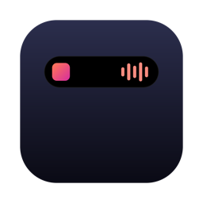
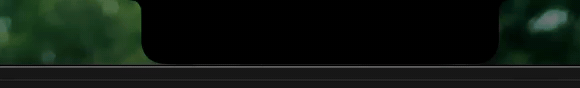

<p align="center">
  
</p>

<h1 align="center">Cove</h1>
<p align="center">A Dynamic Island for your MacBook's notch. Free and open source.</p>

<p align="center">
  
</p>

## What it does
- **Music**: compact artwork + equalizer around the notch; an iPhone-style player with scrubbing, audio output picker and volume when you click.
- **Live activities**: timer, next meeting with a Join button, downloads. A second activity shows as a bubble.
- **Alerts**: charger, low battery, Low Power Mode, AirPods with battery, unlock, online/offline, Focus, screenshots.
- **HUD**: optional replacement for the macOS volume/brightness overlay.
- **Shelf**: drop files, images, links or text on the notch to hold them, drag them back out later. Right-click an item to copy text from an image (OCR), convert to PNG/JPEG, zip it or AirDrop it.
- **Home view**: click the island with nothing playing for the time, today's events, batteries, weather and shortcuts.
- **Gestures and shortcut**: swipe two fingers on the island to skip tracks; press to expand; ⌃⌥Space opens it from anywhere.
- **Camera/mic indicator**: green or orange dot while an app is using them.
- Works on Macs without a notch too: the island becomes a pill in the menu bar.

Every feature can be turned off in Settings. Available in English and Portuguese (Brazil), and it respects Reduce Motion.

## Install
```bash
brew install --cask euraphhh/tap/cove
```
If Homebrew complains about an untrusted tap, run `brew trust euraphhh/tap` first.

Or download `Cove.zip` from [Releases](https://github.com/euraphhh/cove-macos/releases/latest), move `Cove.app` to `/Applications` and run:
```bash
xattr -cr /Applications/Cove.app
```
Cove is not notarized by Apple, so macOS blocks it until the quarantine flag is removed.

Updates arrive inside the app (menu bar icon > **Check for Updates…**).

**Requirements:** Apple Silicon Mac, macOS 14 Sonoma or later.

## Permissions
Cove only asks when you turn a feature on:
| Feature | Permission |
| --- | --- |
| Music (Spotify / Apple Music) | Automation |
| Headphones alert | Bluetooth |
| Meetings | Calendar |
| Volume/brightness HUD | Accessibility |
| Downloads | Downloads folder |
| Focus | Full Disk Access |
| Weather (optional) | Location, or type a city instead |

## Build from source
```bash
./scripts/install.sh   # builds, installs to /Applications and launches
```
Optional: `./scripts/create-dev-cert.sh` once, so macOS keeps permissions across rebuilds.

## License
MIT
